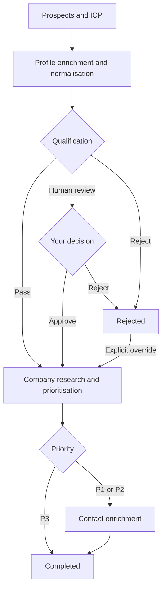

# AI Lead Scoring and Prioritisation

Research B2B prospects, check their fit against your ideal customer profile, and prioritise the leads worth following up with.

Add people individually or upload a CSV, define your target customers, and start a scoring run. The app enriches profiles and company information, pauses uncertain qualification decisions for human review, and presents priorities with supporting evidence. P1 and P2 prospects also proceed to contact enrichment.

**Run the complete app locally with Docker.** Demo mode works without provider accounts or API keys. Live mode uses your own provider accounts and credits. The dashboard and API are served together; no separate frontend build is required.

## Quick start

You need Docker with Docker Compose v2, a running Docker engine, and internet access for the first build. You do not need Python, Node.js, PostgreSQL, or Redis installed on your computer for the Docker setup.

1. Clone this repository using its GitHub **Code** button, or download and extract its source ZIP.
2. Open a terminal in the folder containing `docker-compose.yml`.
3. Start the app:

   ```bash
   docker compose up --build -d --wait --wait-timeout 180
   ```

4. Open **[http://localhost:8000](http://localhost:8000)**.

A fresh checkout starts in **demo mode**, with an empty database. No `.env` file is required for this first run. Docker starts PostgreSQL, Redis, schema migrations, the API/dashboard, the background worker, and the workflow coordinator. Initial image and dependency downloads may take several minutes.

If you already have a `.env`, its settings apply. In particular, `APP_MODE=live` enables paid providers, and `APP_PORT` changes the browser port.

### Try the demo

1. Select **Load demo setup** to fill in example customer criteria and six fictional prospects.
2. Select **Score Prospects** and watch the stages update.
3. Open **View Details** to inspect qualification decisions, priority evidence, and stage history.
4. Review **Sam Rivera** in the human-review tab. Approve to continue processing, or reject to stop.
5. Compare the completed P1, P2, and P3 results and the rejected example.

Demo mode uses scripted outcomes and fictional contact data. It does not fetch LinkedIn profiles, call paid providers, or evaluate your custom criteria. Use it to understand the workflow before configuring live processing.

### Use a different port

If port 8000 is occupied, create `.env` from [.env.example](.env.example), or edit your existing `.env`, and set:

```dotenv
APP_PORT=8001
```

Run the startup command again, then open `http://localhost:8001`. Use that port for the API and documentation too.

## Using the product

### 1. Define your ideal customer profile

Set the target company size, industries, company types, departments or functions, seniorities, and geographies. Add optional exclusions such as agencies or consultancies. The dashboard requires the main customer criteria before starting a run.

For API requests, a company-size maximum must be at least its minimum. Each criteria list accepts up to 50 nonblank entries, with up to 500 characters per entry.

### 2. Add prospects

Use **Single Prospect** to add a name and a LinkedIn person-profile URL, or choose **CSV Upload**. A batch accepts 1–250 prospects. Names must contain 1–255 characters after trimming; URLs must point to a supported LinkedIn `/in/` profile, rather than a company page.

Use [examples/prospects.csv](examples/prospects.csv) as a template:

```csv
Name,LinkedIn Profile URL
Alex Morgan,https://www.linkedin.com/in/demo-alex-morgan
Sam Rivera,https://www.linkedin.com/in/demo-sam-rivera
```

The supplied CSV contains fictional demo identifiers. Replace them with actual prospect information when using live mode. Review the upload summary for invalid rows before submitting.

### 3. Score and review

Processing happens in the background, independently for each prospect. A human-review decision pauses only that prospect; other prospects continue. You can approve or reject individual review cases, apply bulk review actions, or explicitly override a rejection to continue research.

The app first qualifies a prospect against the ICP. Prospects that pass, or that you approve, proceed to company research and prioritisation:

| Result | Meaning | Next step |
| --- | --- | --- |
| **P1** | Strong ICP alignment with multiple supported positive evidence areas | Contact enrichment |
| **P2** | Plausible fit with incomplete, mixed, or uncertain evidence | Contact enrichment |
| **P3** | Weak alignment, mismatch, or materially insufficient support | Complete without contact enrichment |
| **Human Review** | Qualification needs a person’s decision | Approve or reject |
| **Rejected** | Qualification rejected the prospect | Stop, unless explicitly overridden |
| **Failed** | A technical or provider error interrupted processing | Inspect the error and retry when appropriate |

Priority and confidence describe the model’s assessment of available evidence. They are not guarantees of buying intent, contact availability, or scoring accuracy.



The diagram shows the successful workflow. Provider failures and callback timeouts appear as recoverable failures, rather than successful completion.

### 4. Inspect results and contacts

The dashboard shows qualification reasons, priority summaries, positive and weak or unknown signals, and detailed processing history. Save a batch page’s URL to reopen that batch while its data remains in your local database.

P1/P2 contact enrichment may return email or phone data. A successful lookup without usable contact methods completes with **No contacts found**. Contact details themselves are accessed through the protected internal API, rather than displayed in the dashboard; see [Contact access](#contact-access).

## Set up live processing

Live mode requires your own provider accounts, access to the configured models and Apify actor, and sufficient provider credits. Submitted prospect and ICP data is sent to the relevant providers for processing.

Create a `.env` only if you do not already have one:

```bash
cp .env.example .env
```

On Windows PowerShell, use `Copy-Item .env.example .env`. You can also copy the file with your file manager. Preserve existing settings when editing an established installation.

Configure these values:

```dotenv
APP_MODE=live
APIFY_API_KEY=your-apify-key
OPENROUTER_API_KEY=your-openrouter-key
COMPANY_ENRICH_API_KEY=your-company-enrich-key
SIGNALHIRE_API_KEY=your-signalhire-key
SIGNALHIRE_CALLBACK_BASE_URL=https://your-reachable-callback-host
INTERNAL_API_KEY=your-private-contact-access-key
```

| Provider | Used for |
| --- | --- |
| Apify | LinkedIn person and associated company profile enrichment |
| OpenRouter / Jev | ICP qualification |
| CompanyEnrich | Additional company information |
| OpenRouter priority model | Company prioritisation and supporting explanations |
| SignalHire | Contact enrichment for P1/P2 prospects |

The model identifiers, timeouts, and concurrency settings are configurable. See [.env.example](.env.example) and [Configuration](docs/CONFIGURATION.md). With Compose, leave database and Redis connectivity to the supplied service configuration; the localhost URLs in `.env.example` support optional host-based Python development.

### Configure the contact callback

SignalHire must be able to reach a callback on your running API. Set `SIGNALHIRE_CALLBACK_BASE_URL` to the externally reachable **base URL**; the app appends `/webhooks/signalhire/<per-request-token>` itself.

For local development, configure a callback host or a tunnel that forwards the webhook path to your local API port. Compose does not create a tunnel, and a provider cannot reach your computer through a `localhost` callback URL. Keep the dashboard and other API routes local.

Then recreate the services to apply the settings:

```bash
docker compose up --build -d --wait --wait-timeout 180
```

Confirm that the dashboard reports **Live mode** before submitting real prospects. Complete existing demo runs before switching modes; changing the mode does not turn saved fictional results into live assessments. Live processing uses provider credits, and retries can incur additional charges.

### Contact access

Set `INTERNAL_API_KEY` to a private value, then supply the same value in the `X-API-Key` header:

```bash
curl "http://localhost:8000/internal/prospects/PROSPECT_ID/contact" \
  -H "X-API-Key: YOUR_INTERNAL_API_KEY"
```

Replace `PROSPECT_ID` with the prospect’s UUID. The endpoint returns the latest contact attempt’s usable data. It returns 409 if that attempt has no usable data, 401 for an invalid key, or 503 if internal access has not been configured. Keep provider keys, the internal key, contact data, and database backups private. `.env` and database backups are excluded from Git by the supplied ignore rules.

## Failures and retries

Open the prospect’s details to inspect its current failure. Correct missing credentials or provider configuration before retrying. **Retry** resumes the failed stage and preserves confirmed upstream results; a contact retry does not repeat company research or prioritisation.

Some failures occur after a provider may already have accepted a paid request. Those cases require confirmation that retrying may cause a **duplicate charge**. They are not automatically resubmitted. Broker publication failures and failures proven to occur before request transmission can recover automatically.

The default contact callback deadline is 15 minutes, controlled by `CONTACT_CALLBACK_TIMEOUT_SECONDS`. A missing callback becomes `CALLBACK_TIMEOUT` and requires confirmed manual recovery. A valid late success can still resolve a timed-out attempt if a newer attempt has not superseded it.

Provider and phase concurrency settings limit simultaneous work across workers; they are not requests-per-minute limits. Queued work may wait for capacity. Detailed recovery and upgrade procedures are in [Workflow recovery](docs/WORKFLOW_RECOVERY.md).

## API usage

Interactive API documentation is available at **[http://localhost:8000/docs](http://localhost:8000/docs)**. Replace the port if you changed `APP_PORT`.

To submit the included fictional batch while running in demo mode:

```bash
curl -X POST "http://localhost:8000/batches" \
  -H "Content-Type: application/json" \
  --data-binary @examples/batch.json
```

The response includes a batch ID. Use it to query progress and prospects:

| Endpoint | Purpose |
| --- | --- |
| `GET /batches/{id}` | Aggregate progress and batch status |
| `GET /batches/{id}/prospects` | Prospect results, with optional state/priority filters |
| `GET /prospects/{id}` | Evidence, decisions, current recovery metadata, and stage history |
| `POST /prospects/{id}/approve` or `/reject` | Decide a human-review case |
| `POST /prospects/{id}/override` | Continue an explicitly overridden rejection |
| `POST /prospects/{id}/retry` | Resume a failed stage |
| `GET /health` | Database and Redis connectivity |
| `GET /health/workflow` | Coordinator liveness, overdue work, and publication/lease issues |

An uncertain API retry requires `{"acknowledge_possible_duplicate_charge": true}` in its JSON body; without acknowledgment it returns 409. The dashboard handles that confirmation for you. See `/docs` for complete schemas and bulk-review endpoints.

## Running and maintaining the app

Run these commands from the project folder:

| Command | Purpose |
| --- | --- |
| `docker compose ps` | Check service status |
| `docker compose logs -f api worker coordinator` | Follow application processing |
| `docker compose logs migrate` | Inspect migration errors |
| `docker compose down` | Stop the stack while keeping saved data |
| `docker compose up -d --wait --wait-timeout 180` | Start it again |

PostgreSQL and Redis use persistent Docker volumes. Stopping or rebuilding containers preserves those volumes. A fresh clone on another computer starts empty; this repository does not distribute saved leads or private database snapshots. The explicit Compose project name is `leadscoringbackend`, so changing this folder’s name on the same Docker engine continues to use that project’s volumes.

**`docker compose down --volumes` deletes the local database and queue volumes.** Back up data you need before deleting volumes or upgrading an existing installation. Follow [backup, upgrade, and rollback instructions](docs/WORKFLOW_RECOVERY.md#upgrade-backup-and-rollback) when updating a populated database, especially from the older workflow implementation. Schema migrations run automatically during normal Compose startup.

### Troubleshooting

| Symptom | What to check |
| --- | --- |
| Docker cannot connect | Start Docker and confirm `docker compose version` works in your terminal. |
| Startup exceeds the wait timeout | Inspect `docker compose ps` and logs. Initial downloads/builds may take longer; rerun the startup command after resolving errors. |
| Browser cannot open the app | Check the API service and your configured `APP_PORT`; confirm another process is not using that port. |
| Prospects remain queued | Check worker/coordinator logs and `/health/workflow`. All application services must be running; capacity limits may delay work. |
| A migration fails | Inspect `docker compose logs migrate`; the API, worker, and coordinator wait for migrations to succeed. |
| P1/P2 contacts time out | Check SignalHire credentials, credits, callback reachability, and the reported failure before retrying. |
| Contact API access fails | Check `INTERNAL_API_KEY`, the `X-API-Key` header, and whether the latest attempt returned usable contacts. |

## Architecture and development

| Component | Responsibility |
| --- | --- |
| FastAPI + Uvicorn | API and dashboard at one origin |
| PostgreSQL + SQLAlchemy | Saved leads, results, review decisions, and durable stage ledger |
| Coordinator | Dispatch committed work, reconcile expired executions, and process callback receipts |
| Celery + Redis | Deliver background-work notifications to workers |
| Alembic | Database schema migrations |
| Provider adapters | Live integrations and separate fictional demo implementations |

The runtime image installs the backend as a Python package and includes the dashboard and migrations. PostgreSQL remains authoritative for pending work; Redis notifications can be republished without granting permission to repeat a paid request. No separate workflow service or frontend toolchain is required.

For development outside the application container, install Python 3.12 or newer and follow [Host-based Python setup](docs/CONFIGURATION.md#run-python-services-on-the-host). That guide covers the optional database/Redis host ports and running the API, worker, and coordinator in separate terminals.

The maintainer’s companion **Leadscoring extras** folder contains regression tests, a smoke-test runner, audit evidence, and maintenance tooling. It is optional, is not required to run this repository, and is not assumed to exist in a GitHub clone. The repair verification run passed 108 backend tests, including PostgreSQL concurrency checks; Docker demo and browser checks were also performed.

## Scope and limitations

- This is a local evaluation application. User login, multi-user isolation, public HTTPS deployment, and production hosting are not included. The default API port binds to `127.0.0.1`.
- Live results depend on provider availability, credentials, account limits, response quality, and callback delivery. The app does not send outreach messages.
- Scoring quality, business impact, and confidence calibration have not been evaluated against a labelled dataset. Review evidence before acting on a result.
- The dashboard includes per-prospect detail and history, but no dedicated history browser or contact-details interface. The [V2 walkthrough video](demo/lead-scoring-walkthrough-v2.mp4) includes illustrative proposed screens; use this README as the guide to available features.

## Author and license

**Charan Prasad** · [LinkedIn](https://www.linkedin.com/in/charan-sprasad/) · [charan@charanprasad.pro](mailto:charan@charanprasad.pro)

Product requirements were defined by the project author. Implementation and testing used AI coding assistance. Released under the [MIT License](LICENSE).
